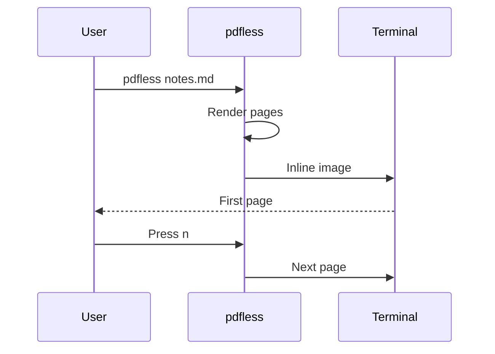

# Markdown and Mermaid sample

A short document for trying out `pdfless` on Markdown: headings, lists, a
table, a code block, and [Mermaid](https://mermaid.js.org) diagrams.

## Rendering pipeline

`pdfless` turns a Markdown file into pages and shows them in the terminal.


- Headings become the table of contents (`o`).
- Links stay clickable.
- Press `t` to see the source.

## Supported content

| Element | Rendered as |
| --- | --- |
| Headings | Bookmarks in the table of contents |
| Tables | Tables with borders |
| Code blocks | Monospaced text on a gray background |
| `mermaid` blocks | Diagrams |

<div style="page-break-before: always"></div>

## Opening a file

What happens between starting `pdfless` and seeing the first page:



## Example code

```python
def greet(name: str) -> str:
    """Return a greeting for `name`."""
    return f"Hello, {name}!"
```
